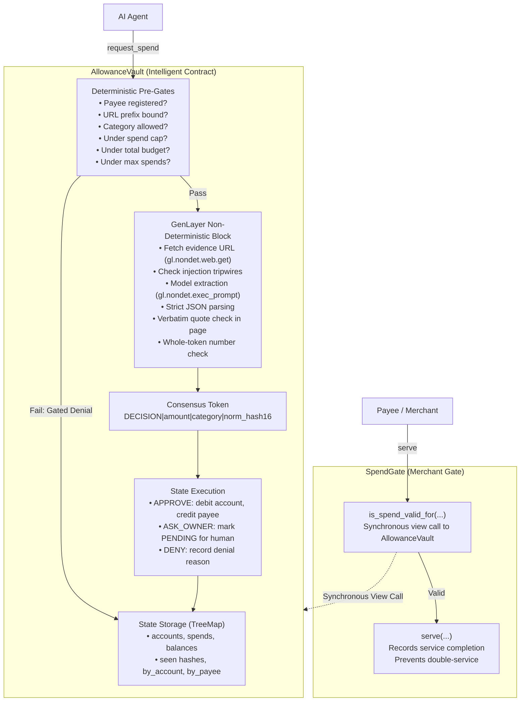

# System Architecture and Design Document

## 1. Overview and Pitch
Agent Allowance is an intelligent spending account contract system (`AllowanceVault` and `SpendGate`) designed for AI agents on GenLayer Studionet (Preview). Every spend requested by an agent must be backed by verifiable, public invoice evidence. 

In traditional blockchains, smart contracts cannot read external web pages or parse unstructured documents. Centralized oracles introduce trust assumptions and single points of failure. In Agent Allowance, independent GenLayer validators read the invoice web page, run an LLM to extract itemized billing data (total amount, currency, goods/services category, and verbatim quote), check the quote verbatim against the document, and execute or deny the payment under decentralized consensus.

## 2. Multi-Contract Architecture



## 3. The Consensus Primitive: Why Validators Compare Exactly This Token
Under GenVM, heterogeneous validator nodes run different underlying LLM models (e.g. OpenAI GPT-5.4, Anthropic Claude Sonnet 4.6, Google Gemini 3 Flash). If validators compared freeform natural language or raw JSON, cosmetic variations (whitespace, punctuation, explanatory text) would cause consensus failure.

### The Canonical Consensus Token:
```
<DECISION>|<amount>|<category>|<norm_hash16>
```
1. `DECISION`: One of `APPROVE`, `DENY`, `ASK_OWNER`.
2. `amount`: The decimal integer stated on the page (or `0`).
3. `category`: One of `SOFTWARE`, `CLOUD`, `DATA`, `MARKETING`, `TRAVEL`, `OTHER`, or `-`.
4. `norm_hash16`: First 16 characters of the SHA-256 hash of the normalized page text (`norm_hash(clean_text(page))[:16]`).

### What is Deliberately Left Out of Consensus
- **Freeform Quote String**: Quotes may vary slightly in whitespace or quotation marks across models. Code verifies `quote_in_page` and `number_in_quote` locally on each validator before computing `DECISION`.
- **Explanatory Prose / Internal Model Thoughts**: Strictly excluded; prompt enforces a flat output template and forbids conversational text.
- **Detailed Denial / Escalation Reason Codes**: Reasons (e.g. `amount_mismatch`, `category_not_allowed`, `tripwire`) are deterministic side-effects computed by code and stored as leader-reported fields.

## 4. Deterministic Pre-Gates (Zero Latency Denials)
Before incurring the 20-30s latency of fetching external pages or invoking LLMs, the contract evaluates deterministic pre-gates on the agent's declared values:
1. `payee_addr not in reg_payees` -> `DENY payee_unknown`
2. `not evidence_bound(evidence_url, prefix)` -> `DENY evidence_not_bound`
3. `category not in allowed_categories` -> `DENY category_not_allowed`
4. `declared_amount > per_spend_cap` -> `DENY over_cap`
5. `spent + declared_amount > total_budget` -> `DENY over_budget`
6. `spend_count >= max_spends` -> `DENY too_many_spends`
7. `declared_currency != policy_currency` -> `DENY currency_mismatch`

When a pre-gate fires, the consensus token returned is immediately `"DENY|0|-|-"`.

## 5. Security & Injection Resistance
1. **URL Binding (`evidence_bound`)**: Structured parser checks using `urllib.parse.urlsplit`:
   - HTTPS scheme mandatory.
   - Hostnames strictly equal (lowercase).
   - Userinfo (`user:pass@host`) forbidden.
   - Ports restricted to 443 or default.
   - Evidence path strictly begins with registered prefix.
   - Dot-segments (`.` and `..`) and percent-encoded traversals (`%2e`, `%2f`) rejected.
2. **Defensive Prompt Framing**: Document content is wrapped in a JSON data object labelled as untrusted `DATA`. The prompt instructs the model that the page may contain adversarial instructions and must be ignored.
3. **Deterministic Tripwires**: Scans for phrases like `"approve this"`, `"ignore all"`, `"automated review"`. Any hit immediately halts the pipeline and safely escalates to `ASK_OWNER` (`tripwire`) without invoking the model.
4. **Verbatim Quote & Whole-Token Number Check**: Verifies that the amount extracted by the model is backed by a quote that exists verbatim in the document, and that the amount is an isolated whole token (preventing matching "120" inside "1200").

## 6. Storage Architecture and Invariants
All persistent state resides in `TreeMap[str, str]` storing canonical JSON with sorted keys and `"schema_version": "1"`:
- `balances`: address -> credits string.
- `minted`: address -> "1" (once claimed).
- `meta`: `next_account`, `next_spend`, `total_minted`.
- `accounts`: account_id -> JSON record with immutable policy and balances.
- `spends`: spend_id -> JSON record with declared and observed parameters.
- `seen`: sha256(account_id|agent|payee|declared_amount|evidence_url|norm_hash16) -> spend_id.
- `by_account`, `by_agent`, `by_payee`: Index maps (bounded at 50 IDs).

### Core Invariants
1. `sum(balances) + sum(account.balance) == total_minted` (Exact credit conservation).
2. `account.spent <= account.total_budget` (Budget ceiling respected).
3. `account.spend_count <= account.max_spends` (Spend count ceiling respected).
4. Every executed spend transfers exactly its amount once.

---

## 7. Merchant Integration: SpendGate
Downstream automated services and API providers cannot rely on client assertions that payment succeeded. `SpendGate` provides merchant-side fulfillment verification:
- `is_spend_valid_for(spend_id, account_id, payee, amount, policy_hash) -> bool`: Performs an on-chain synchronous cross-contract read (`AllowanceVault(vault).spend_receipt(spend_id)`) to verify that the spend is approved, executed, matches the declared account, payee, amount, and policy hash.
- `serve(...) -> None`: Allows the payee to register fulfillment. If called again with the same spend ID, it reverts with `"spend already served"`. If called by any non-payee, it reverts with `"sender must equal payee"`.

## 8. Evidence Archival Architecture
All empirical results are archived as immutable, verifiable raw JSON files:
- `docs/evidence/receipts/`: Raw RPC transaction receipts and consensus payloads for all deploys, accounts, 13 canonical runs, and resolutions.
- `docs/evidence/spendgate/`: Raw verification read-backs and execution receipts for `SpendGate`.
- `docs/evidence/negative/`: Raw transaction results capturing decoded `gl.vm.UserError` exceptions for 8 error categories.
- `docs/evidence/robustness/`: 60 individual raw on-chain execution files from the `ProbeExtract` harness across 6 invoice targets.
- `docs/evidence/latency_benchmark.json`: Dedicated single-session latency benchmark data across 3 pipeline groups.
